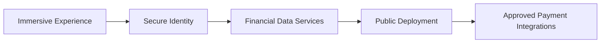

<div align="center">


# THE FINANCIAL EXPERIENCE, REIMAGINED.

### Where technology, imagination and money move together.


**IMMERSIVE DESIGN · INTERACTIVE FINANCE · 3D TECHNOLOGY**

</div>

---

## 01 — INTRODUCING VYRA

**VYRA** reimagines the digital financial experience through expressive interfaces, fluid animation, 3D interactions, and thoughtful financial visualization.

Built to make everyday money management feel intuitive, personal, and visually extraordinary.

> Finance should be understandable. Technology should be seamless. Experiences should be unforgettable.

## 02 — THE VYRA EXPERIENCE

| EXPERIENCE | CAPABILITIES |
|:---|:---|
| **HOME** | Financial overview, 3D money core, recent activity and quick actions |
| **PAY** | Interactive payment and request simulations |
| **FLOW** | Visual spending patterns and transaction insights |
| **CIRCLES** | Shared expense and group balance visualization |
| **VAULTS** | Personal savings goals, contributions and progress tracking |
| **IDENTITY** | Account registration, authentication and individual sessions |

## 03 — TECHNOLOGY BEHIND THE EXPERIENCE

```text
                    V Y R A
                       |
         +-------------+-------------+
         |                           |
     FRONTEND                     BACKEND
         |                           |
    React + TypeScript           FastAPI
    Three.js + Fiber             Python
    Motion                       SQLite
    Vite                         JWT Authentication
         |                           |
         +-------------+-------------+
                       |
              FINANCIAL EXPERIENCE
```

## 04 — BUILT TO FEEL DIFFERENT

- Cinematic welcome experience
- Interactive three-dimensional payment card
- Expressive editorial typography
- Smooth navigation and animated transitions
- Custom cursor interactions
- Financial activity visualization
- Personal savings vaults
- Responsive layout
- Password-based signup and login
- Local financial simulation

## 05 — RUN VYRA LOCALLY

Clone the repository:

```bash
git clone https://github.com/oishipaul45-engineer/VYRA.git
cd VYRA
```

Install frontend dependencies:

```bash
npm install
```

Start the frontend:

```bash
npm run dev
```

The frontend normally opens at `http://localhost:5173`.

The authentication backend is located in `backend/` and requires a local environment configuration.

## 06 — PRODUCT DEVELOPMENT



**The current direction:** an increasingly capable financial application combining thoughtful design, account identity, savings tools, money visualization, and future payment connectivity.

## 07 — FINANCIAL INTEGRITY

VYRA currently supports simulated financial activity. Real bank transfers, UPI transactions, and settlement are not enabled. Actual payment features will require appropriate regulated providers, security controls, and approvals.

---

<div align="center">

### NOT JUST SOFTWARE. AN EXPERIENCE.

**VYRA — MONEY IN MOTION.**

Designed & Developed by **[Oishi Paul](https://github.com/oishipaul45-engineer)**

[](https://github.com/oishipaul45-engineer/VYRA)


</div>