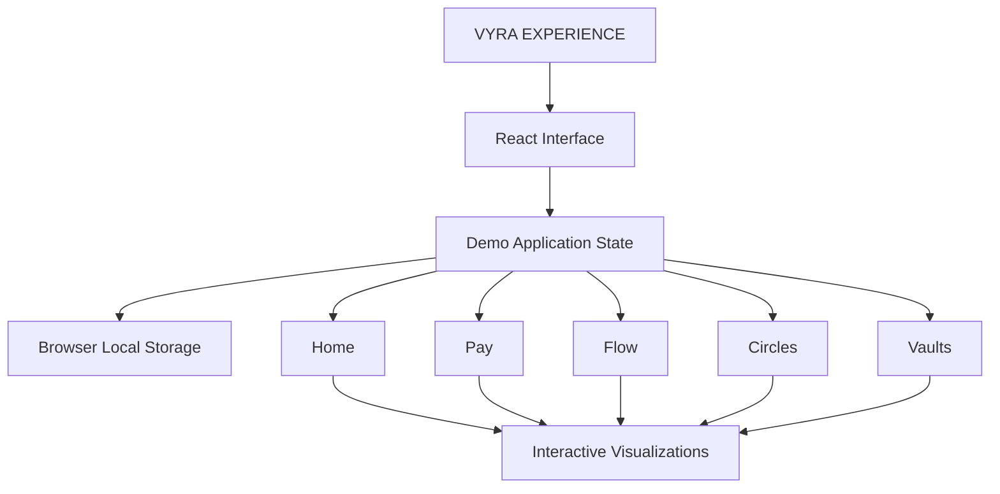

<div align="center">


### NOT ANOTHER FINANCE DASHBOARD.

**An experimental financial experience where motion, money and imagination meet.**


<br/>


<br/>


**[THE PROJECT](https://github.com/oishipaul45-engineer/VYRA) | [THE CREATOR](https://github.com/oishipaul45-engineer)**

</div>

---

## 01 / THE VISION

> What if managing money felt less like using software and more like experiencing something alive?

**VYRA** is a visually experimental fintech frontend that explores a different way to interact with financial information.

Rather than relying on conventional dashboards, VYRA combines expressive typography, animated interfaces, interactive 3D elements, and playful financial visualizations.

It is designed around one idea:

**Money is always moving. Its interface should feel alive, too.**

---

## 02 / FIVE SPACES. ONE EXPERIENCE.

| EXPERIENCE | DESCRIPTION |
|:---|:---|
| **01 / HOME** | A personal money overview with a living 3D core, recent activity, quick actions and financial highlights. |
| **02 / PAY** | An interactive studio for recording simulated payments and requests. |
| **03 / FLOW** | A visual exploration of spending patterns and transaction activity. |
| **04 / CIRCLES** | Demo shared-expense groups and balances, presented as connected financial spaces. |
| **05 / VAULTS** | Savings goals that you can create, contribute to, and track visually. |

### The details matter.

- Cinematic welcome experience
- Three-dimensional payment-card visualization
- Interactive money and spending displays
- Smooth page transitions and animation
- Expressive, experimental typography
- Custom cursor experience
- Savings-goal progress
- Responsive navigation
- Reduced-motion preference
- Local demo-data persistence

---

## 03 / THE TECHNOLOGY

<div align="center">

| LAYER | TECHNOLOGY |
|:---|:---|
| Interface | React |
| Language | TypeScript |
| Development | Vite |
| 3D Graphics | Three.js |
| React 3D | React Three Fiber |
| 3D Helpers | Drei |
| Animation | Motion |
| Icons | Lucide React |
| Demo Storage | Browser localStorage |

</div>

```text
        V Y R A
    MONEY IN MOTION
             |
       REACT + TS
             |
    +--------+--------+
    |        |        |
   MOTION    3D      DATA
    |        |        |
   Motion  Three.js  Local state
             |
     THE EXPERIENCE
```

---

## 04 / RUN IT LOCALLY

Clone the project:

```bash
git clone https://github.com/oishipaul45-engineer/VYRA.git
```

Enter the directory:

```bash
cd VYRA
```

Install dependencies:

```bash
npm install
```

Launch the development server:

```bash
npm run dev
```

Open the local address displayed by Vite, usually:

```text
http://localhost:5173
```

### Build and checks

```bash
npm run build
npm run preview
npm run lint
```

---

## 05 / HOW IT WORKS



VYRA currently stores demo information locally in the browser.

Payment actions create simulated records. They do not contact a bank or transfer real money.

---

## 06 / THE ROAD AHEAD

| PHASE | DIRECTION |
|:---|:---|
| **I / EXPERIENCE** | Interactive frontend and visual identity |
| **II / IDENTITY** | Secure account registration and login |
| **III / FOUNDATION** | Backend APIs and database |
| **IV / CONNECTION** | Deployment and richer collaborative features |
| **V / REAL PAYMENTS** | Explore regulated payment partnerships and required approvals |

The long-term vision is to explore how a more expressive financial product could work beyond a prototype.

---

## 07 / PROJECT STRUCTURE

```text
VYRA/
|
+-- public/
|
+-- src/
|   +-- assets/
|   +-- components/
|   |   +-- ExperimentalWelcome.tsx
|   |   +-- MoneyCore.tsx
|   |   +-- FlowPanel.tsx
|   |   +-- VyraCursor.tsx
|   |
|   +-- data/
|   +-- App.tsx
|   +-- main.tsx
|   +-- styles.css
|
+-- package.json
+-- vite.config.ts
+-- README.md
```

---

## 08 / IMPORTANT NOTE

**VYRA is currently an experimental financial interface and payment simulator.**

No real banking accounts, UPI transfers, or financial settlements are connected.

Displayed balances, payments, savings contributions and shared-expense figures are demo data.

Do not enter real banking credentials, PINs or sensitive financial information.

---

<div align="center">

### BUILT DIFFERENT. BUILT TO MOVE.

*Financial experiences do not have to feel ordinary.*

**Designed & Developed by [Oishi Paul](https://github.com/oishipaul45-engineer)**

[](https://github.com/oishipaul45-engineer/VYRA)

<br/>

**VYRA / MONEY IN MOTION**


</div>