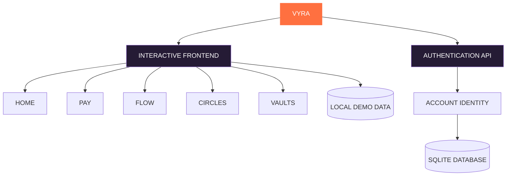
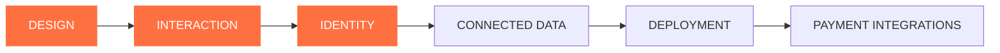

<div align="center">


### THE FINANCIAL EXPERIENCE, REIMAGINED.


<br/>

**An immersive financial experience where technology becomes intuitive, interactions become expressive, and money becomes something you can understand at a glance.**

<br/>

[](https://react.dev/)
[](https://www.typescriptlang.org/)
[](https://threejs.org/)
[](https://fastapi.tiangolo.com/)

<br/>

[**DISCOVER VYRA**](#-the-five-dimensions) · [**EXPLORE THE ARCHITECTURE**](#-inside-the-system) · [**RUN LOCALLY**](#-enter-vyra)

</div>

---


## 🌐 VYRA — LIVE WEBSITE

**[🚀 LAUNCH VYRA](https://vyra-production-adbf19d0.up.railway.app)**

Experience VYRA's interactive 3D fintech interface, account system, savings Vaults, Circles, and simulated payments.

**Status:** Public beta | Hosted on Railway

> VYRA currently uses simulated financial transactions. No real-money transfers are enabled.

---

## `01 / THE MANIFESTO`

### Finance doesn't need another ordinary interface.

It needs clarity. Personality. Movement.

**VYRA** explores a new language for digital finance—one where spending becomes a visual story, savings become visible progress, and financial interactions feel fluid rather than mechanical.

We believe a financial interface should be more than a collection of numbers.

> **Don't just track the movement. Experience it.**

```text
╔══════════════════════════════════════════════════════╗
║                                                      ║
║   V Y R A                                            ║
║                                                      ║
║   01  SEE THE MONEY.                                 ║
║   02  FEEL THE MOVEMENT.                             ║
║   03  OWN THE EXPERIENCE.                            ║
║                                                      ║
║   A DIFFERENT WAY TO INTERACT WITH FINANCE.           ║
║                                                      ║
╚══════════════════════════════════════════════════════╝
```

---

## `02 / THE FIVE DIMENSIONS`

### One experience. Five connected spaces.

<table>
<tr>
<td width="50%">

### 01 — HOME
**Your financial universe, at a glance.**

An expressive overview with a 3D money core, recent activity, financial highlights and quick actions.

</td>
<td width="50%">

### 02 — PAY
**Money, in motion.**

A focused interface for simulated payments and requests, with clear confirmation and transaction recording.

</td>
</tr>
<tr>
<td>

### 03 — FLOW
**Give your spending a shape.**

Explore transaction activity and spending patterns through an interactive visual experience.

</td>
<td>

### 04 — CIRCLES
**Better together.**

Visualize shared expenses, group balances and the financial relationships that connect people.

</td>
</tr>
<tr>
<td colspan="2" align="center">

### 05 — VAULTS
**Tomorrow starts with what you save today.**

Create personal savings goals, add contributions and see your progress move toward something meaningful.

</td>
</tr>
</table>

---

## `03 / THE EXPERIENCE ENGINE`

VYRA blends modern frontend engineering with a deliberately unconventional visual identity.

| EXPERIENCE LAYER | TECHNOLOGY | PURPOSE |
|:---|:---|:---|
| Interface | React | Component-driven experience |
| Language | TypeScript | Typed application logic |
| Visual engine | Three.js | Interactive 3D rendering |
| 3D integration | React Three Fiber + Drei | React-based 3D experiences |
| Motion | Motion | Animated interactions |
| Design language | CSS | Editorial layouts and styling |
| Backend | FastAPI | Authentication API |
| Storage | SQLite | Local user accounts |
| Identity | JWT | Authenticated sessions |
| Tooling | Vite | Frontend development and builds |

<details>
<summary><b>✦ Explore the interaction details</b></summary>

<br/>

- Cinematic entrance with an interactive 3D payment card
- Expressive typography and asymmetric compositions
- Animated transitions between financial spaces
- Custom cursor interactions
- Local transaction and savings simulation
- Reduced-motion preference
- Amount visibility controls
- Responsive interface and navigation
- Account creation and password-based login

</details>

---

## `04 / INSIDE THE SYSTEM`



The application currently uses a FastAPI authentication backend and browser-local simulated financial data.

---

## `05 / ENTER VYRA`

### Start the experience on your machine.

**01 — Clone the source**

```bash
git clone https://github.com/oishipaul45-engineer/VYRA.git
cd VYRA
```

**02 — Install the frontend**

```bash
npm install
```

**03 — Launch the interface**

```bash
npm run dev
```

**04 — Launch the local backend**

Create `backend/.env` with a private `VYRA_JWT_SECRET` of at least 32 characters.

Install Python dependencies from `backend/requirements.txt`, then start the FastAPI server:

```bash
cd backend
python -m pip install -r requirements.txt
python -m uvicorn app:app --port 8000
```

Open the address printed by Vite to enter VYRA.

> Never commit `backend/.env`, authentication secrets or local user databases.

---

## `06 / THE JOURNEY`



**Current foundations:** immersive frontend, simulated financial workflows and local authentication.

**Next direction:** persistent account-linked financial data, deployment, better insights and collaborative features.

**Long-term exploration:** real payment connectivity through appropriately regulated partners, with the required compliance and security controls.

---

## `07 / FINANCIAL INTEGRITY`

VYRA's current payment and balance experiences are simulations. No actual bank transfers, UPI settlements or real-money transactions are enabled.

The authentication system is intended for local development and needs additional production security work before public deployment.

---

<div align="center">

### FINANCE, WITHOUT THE ORDINARY.


<br/>

**CREATED BY [OISHI PAUL](https://github.com/oishipaul45-engineer)**

[](https://github.com/oishipaul45-engineer/VYRA)

<br/>

**VYRA® / MONEY IN MOTION**


</div>